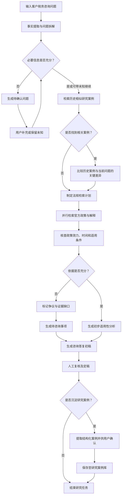

# Agent Handoff — Tax Research Agent 工作流升级方案

## 一、项目背景

当前项目为 `tax_agent`，已具备一定的税务 Agent 基础能力，包括：

- LangGraph 工作流及多个专业子 Agent。
- RAG 税务政策知识库。
- 官方政策检索与政策更新。
- 税额计算工具。
- 文档上传和解析。
- SQLite、Qdrant 数据存储。
- 对话历史、记忆及人工审核等功能。

上述能力来自现有项目文档，具体实现情况需要阅读代码核实。

### 本次产品定位

将现有项目进一步发展为：

**Tax Research Agent —— 面向财税专业人员的税务研究与咨询辅助工具。**

核心目标是帮助财税人员完成税务咨询中的政策 Research 工作，而不只是回答税法知识问题。

希望覆盖：

1. 税务问题拆解。
2. 业务事实提取与信息补全。
3. 历史相似研究案例检索。
4. 新旧案例差异分析。
5. 法规政策检索与适用性核验。
6. 咨询答复初稿生成。
7. 人工复核。
8. 研究案例沉淀与复用。

**历史案例检索与沉淀必须融入 Research Agent 主工作流，不应另外设计一套独立的案例 Agent。**

本轮只进行代码审查和方案设计，不修改项目代码。

---

## 二、目标工作流

以下是预期业务流程：

该流程为产品设计基准，而非要求代码中必须逐一实现相同数量的 LangGraph 节点。

请根据现有架构判断哪些步骤适合：

- LangGraph 节点。
- 现有专业 Agent。
- 独立工具函数。
- 普通 Python 业务逻辑。
- 前端交互。
- 人工审核。

不要为了增加 Agent 数量而过度拆分。

---

## 三、第一阶段：审查现有项目

请先检查以下模块及其实际调用关系。

### 1. Agent 工作流

重点关注：

- `agents/tax_agent.py`
- `agents/base_agent.py`
- `agents/intent_router.py`
- `agents/sub_agents/`
- LangGraph 状态定义与路由
- 人工审核、中断和恢复逻辑

请回答：

1. 当前 LangGraph 主工作流是什么？
2. 当前是否已经具备研究计划拆解能力？
3. 当前政策检索通过哪些工具和 Agent 执行？
4. 是否支持多个检索任务并行？
5. 如何在不破坏普通问答能力的情况下引入 Research 工作流？
6. 是否需要设置 Research 模式入口，还是复用现有意图路由？

### 2. 记忆与知识库

重点关注：

- `agents/memory.py`
- `knowledge/kb.py`
- `knowledge/kb_manager.py`
- `knowledge/policy_updater.py`
- 相关 SQLite 数据结构
- Qdrant 集合、payload 与检索机制

请区分以下概念：

**对话记忆**

保存对话历史与必要的上下文。

**政策知识库**

保存法规、政策解释及相关官方资料。

**研究案例库**

保存经过确认的历史税务研究成果，用于后续相似案例检索与经验复用。

这三者不应直接混用。

请评估现有存储架构如何支持研究案例库，并比较：

- SQLite 结构化存储。
- Qdrant 语义检索。
- 两者组合。

优先复用现有技术。

### 3. 前端与任务状态

检查当前前端是否支持：

- 普通问答与 Research 模式切换。
- 研究任务进度显示。
- 待确认问题交互。
- 历史案例引用。
- 结构化研究报告。
- 人工审核及修改。
- 案例保存确认。

请分析最小必要改动，不要直接设计复杂的企业级工作台。

---

## 四、核心功能设计

### 功能 A：税务问题拆解

用户输入客户提出的税务咨询问题。

系统应识别：

- 涉及税种。
- 业务背景。
- 企业所在地。
- 税款所属期。
- 可能适用的政策领域。
- 已确认事实。
- 缺失的关键事实。
- 研究目标。

对于缺失的重要条件，应允许用户补充。

但不能因用户暂时无法提供全部信息而无限循环追问。

对于可以继续研究的任务，应保留未知条件，形成有条件的初步分析。

请设计合理的追问次数限制和人工跳过机制。

### 功能 B：历史研究案例检索

在完成问题初步理解后，系统检索历史案例。

要求：

1. 根据业务事实、税种、地区及所属期等信息进行检索。
2. 不能只依赖文本相似度判断案例适用性。
3. 找不到相关案例时正常继续流程。
4. 不应因为检索到历史案例就跳过官方政策检索。
5. 不应把历史案例结论直接视为当前问题的答案。

请评估是否需要：

- 向量检索。
- 元数据过滤。
- 相似度排序。
- 结构化条件比较。

MVP 以准确、可解释和低复杂度为优先目标。

### 功能 C：历史案例差异比较

对于召回的历史案例，比较：

- 涉及税种。
- 业务模式。
- 企业类型。
- 地区。
- 税款所属期。
- 关键适用条件。
- 相关政策。
- 事实不确定性。

输出应区分：

- 相似事实。
- 关键差异。
- 尚无法比较的条件。
- 值得参考的历史研究线索。

不要直接输出「历史案例适用」等未经核验的确定性判断。

### 功能 D：法规研究与交叉核验

根据当前问题和历史案例线索，制定政策检索计划。

优先检索：

- 官方税收法律法规。
- 财政部、国家税务总局等官方政策文件。
- 地方税务机关公开的政策解释。
- 其他有必要的权威资料。

需要考虑：

- 政策来源真实性。
- 政策发布日期。
- 实施日期。
- 失效或废止情况。
- 适用地区。
- 适用税款所属期。
- 具体条款。
- 政策文件之间的关系。

对于无法核实的信息，应保留不确定性。

请评估现有 RAG 和联网检索工具能支持到什么程度，以及是否存在需要优先修复的缺陷。

### 功能 E：研究报告生成

研究完成后生成结构化初稿。

建议包含：

1. 原始咨询问题。
2. 研究范围与背景。
3. 已确认事实。
4. 待确认事实。
5. 相关政策依据。
6. 历史相似案例及差异。
7. 初步税务分析。
8. 潜在争议或不确定事项。
9. 建议向客户或税务机关进一步确认的问题。
10. 咨询答复参考文本。

需要区分：

**事实、政策规定、历史经验、AI 分析。**

报告必须能够追溯政策来源。

不允许编造法规、条款或历史研究记录。

### 功能 F：人工复核

生成报告后，用户可以：

- 查看引用来源。
- 修改研究结论。
- 补充信息。
- 删除不准确的内容。
- 确认定稿。

请评估如何复用现有 Human-in-the-loop 机制。

不要求所有简单税务问答都必须进入人工审核流程。

### 功能 G：研究案例沉淀

用户完成研究后，可选择将本次研究保存为结构化案例。

建议字段包括：

- Case ID。
- 研究主题。
- 原始咨询问题。
- 税种。
- 地区。
- 税款所属期。
- 企业或业务类型。
- 已确认业务事实。
- 关键适用条件。
- 政策依据及来源。
- 研究结论。
- 未解决事项。
- 审核状态。
- 来源任务 ID。
- 创建时间与更新时间。

请根据实际数据库结构调整字段，不必机械照搬。

**只有经过用户确认的研究成果才能进入正式可复用案例库。**

不能把普通对话、尚未验证的模型推理和临时假设自动写入正式案例库。

需要支持案例删除、修改以及必要的版本记录。

---

## 五、数据安全与知识隔离

需要重点考虑：

1. 公共税务法规与用户私有研究案例分开管理。
2. 历史案例不得跨用户或跨权限范围泄露。
3. 不应自动保存未经确认的客户敏感信息。
4. 支持对企业名称、合同编号、金额及其他敏感字段进行删除或泛化处理。
5. 明确哪些信息会发送给外部 LLM。
6. 研究案例检索时不得将私有内容混入公共知识库。
7. 不要将提示词中的保密要求视为真正的数据安全机制。

当前 MVP 面向个人使用，可以先设计个人案例库。

暂不开发复杂团队协作和企业级权限管理。

---

## 六、Agent 与 Skill 的边界

本项目希望继续积累 Agent 工程经验。

但不能为了展示 Agent 而人为增加复杂度。

请重点评估：

**哪些功能需要动态任务规划、工具选择、状态管理或人工介入，哪些只需要固定流程和工具函数？**

特别关注：

- 简单咨询问题能否走轻量路径。
- 复杂咨询是否需要动态制定研究计划。
- 如何决定需要检索哪些政策。
- 检索结果不足时如何补充检索。
- 历史案例能否影响后续研究计划。
- 何时应停止研究并明确提示证据不足。
- 如何限制循环检索和模型调用成本。

请提出一个尽可能简单、但能体现真实 Agent 能力的方案。

---

## 七、MVP 开发阶段

建议按照以下阶段拆分。

### P0：Research 工作流

完成：

- 税务问题解析。
- 必要信息补全。
- 研究计划。
- 政策检索与核验。
- 结构化研究初稿。
- 人工审核。

优先复用现有代码。

### P1：历史案例检索与复用

完成：

- 结构化案例存储。
- 相似案例检索。
- 新旧业务条件比较。
- 研究计划利用历史案例线索。

### P2：案例沉淀与维护

完成：

- 研究结果结构化提取。
- 用户确认入库。
- 案例修改和删除。
- 案例审核状态及必要的历史版本。

如果实际依赖关系要求先实现案例存储，可调整顺序。

但对用户而言，最终三个阶段必须构成统一的 Research 工作流。

本次暂不开发：

- 12366 自动电话咨询。
- 企业完整财务数据风险审查。
- 海外税收政策自动监测。
- 企业 Desk Research。
- 团队案例共享。
- 政策更新自动触发历史案例复核。

---

## 八、评测与验收

请设计 Research Agent 的评测方案。

重点评估：

- 研究问题拆解正确率。
- 关键缺失信息识别能力。
- 相关政策检索效果。
- 政策引用准确率。
- 政策适用时间核验。
- 相似案例召回质量。
- 关键业务差异识别能力。
- 历史错误结论继承风险。
- 报告完整性。
- Agent 执行时间和模型调用成本。

建议使用公开税务政策、官方案例及经过核验的模拟研究任务构建测试集。

不得将模型自行生成的答案直接作为标准答案。

建议额外设计对照测试：

**同一 Research Agent，开启与关闭历史案例检索，比较研究准确性、完成时间和调用成本。**

这样能够验证案例复用是否真正有价值。

---

## 九、本轮交付内容

本次只输出实施方案，不执行修改。

请按以下结构交付：

### 1. 现有代码分析

列出当前架构、实际工作流程和可复用模块。

引用关键文件路径及实现位置。

### 2. 目标工作流与架构映射

说明每个业务步骤对应：

- 现有 Agent。
- 新增 LangGraph 节点。
- 工具函数。
- 数据库操作。
- 前端交互。

### 3. 数据模型方案

提出研究任务、研究案例、政策引用及审核状态的数据结构。

说明 SQLite 与 Qdrant 如何分工。

### 4. 前端交互方案

重点考虑研究模式、研究报告、历史案例引用、案例保存确认。

### 5. 开发任务清单

按 P0、P1、P2 拆分任务。

每项任务列出涉及文件、依赖、开发内容和验收条件。

### 6. 技术风险与取舍

指出当前实现中的主要限制，以及建议暂缓的复杂功能。

### 7. 推荐实施顺序

给出适合个人开发者的渐进式开发方案。

---

## 十、执行约束

1. 先阅读真实代码，不得仅根据 README 推断实现。
2. 本轮不得修改、删除或创建项目文件。
3. 不得运行可能修改生产数据或真实知识库的脚本。
4. 不得擅自调整数据库或 Qdrant 集合。
5. 不得引入新的 Agent 框架或无必要的复杂依赖。
6. 不得凭空假设类、接口或数据字段。
7. 不得修改现有税务政策与业务规则。
8. 必须保留普通税务问答功能。
9. 对尚未验证的技术假设，应明确标记。
10. 完成方案后停止，等待用户审核，再进入实施阶段。

**最终目标：构建一个以真实税务咨询 Research 工作为核心，能够复用历史研究经验，并且具有可靠政策引用与人工复核机制的 Tax Research Agent。**